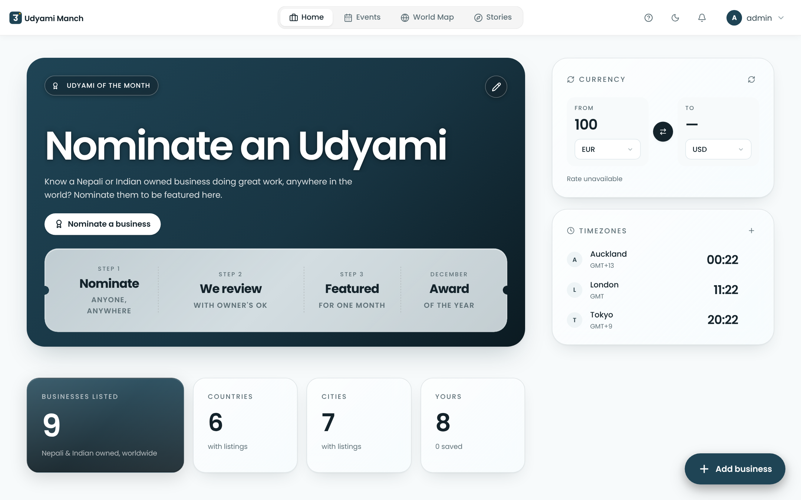
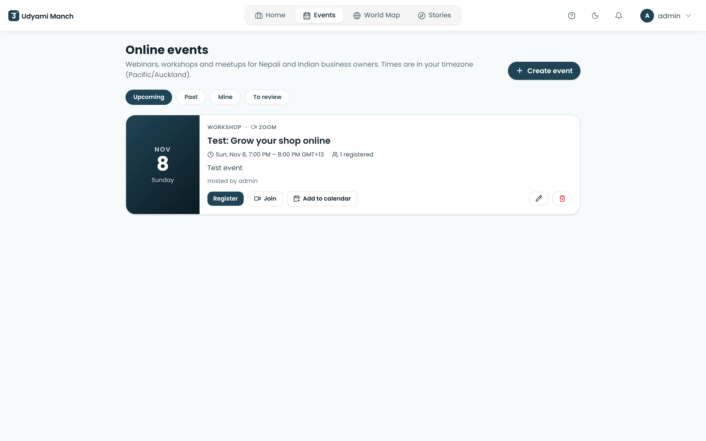
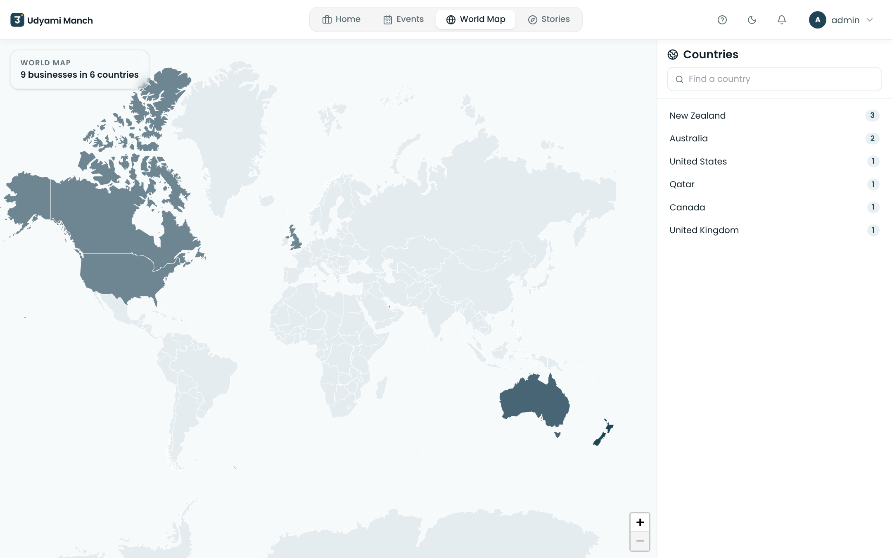
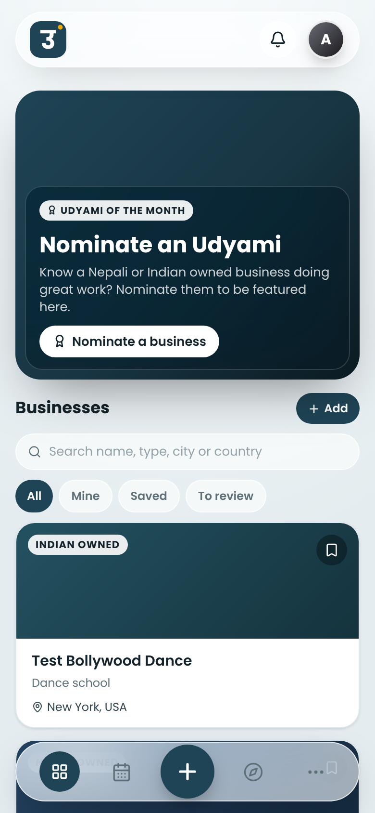
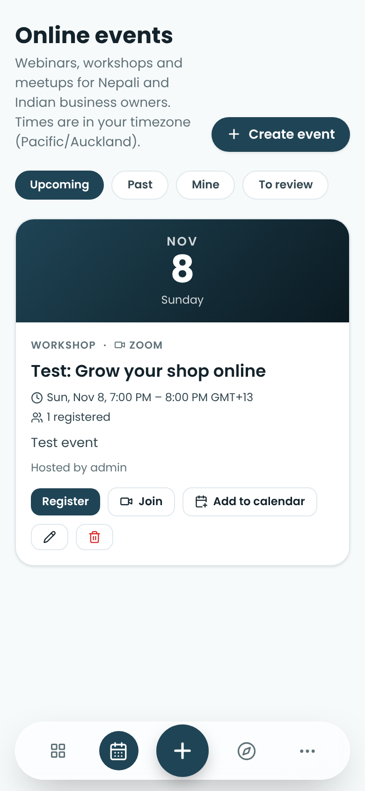
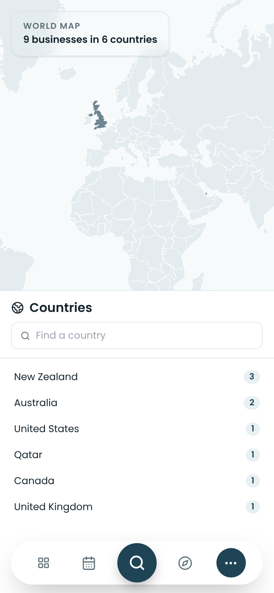

<p align="center">
  <picture>
    <source media="(prefers-color-scheme: dark)" srcset="client/public/text-light.svg">
    
  </picture>
</p>

<p align="center"><b>Your people. Your market.</b></p>

<p align="center">
  A worldwide directory of businesses owned and run by Nepalis and Indians.<br>
  Find a shop, a restaurant, a tradie or a service owned by someone from your community, wherever you live.
</p>

<p align="center">
  
  
  
  
</p>

<p align="center">
  
</p>

## What you get

<table>
<tr>
<td width="33%" valign="top">

### 🏪 Directory
Search by country, city, category and community. Save the businesses you like. Every listing is reviewed before it goes public.

</td>
<td width="33%" valign="top">

### 🏆 Udyami of the Month
One business is featured each month, chosen from community nominations. Nominate someone doing great work.

</td>
<td width="33%" valign="top">

### 🎥 Online events
Webinars, workshops and meetups on Zoom, Meet, Teams or YouTube. Times show in your own timezone.

</td>
</tr>
</table>

<p align="center">
  
  
</p>

<p align="center"><sub>Online events (left) and the world map of listed businesses (right)</sub></p>

## Built for your phone

<p align="center">
  
  
  
</p>

Installs on your phone like an app, with no app store. Home, Events, a quick **+** to add a business, Stories and More.

## Features

- **List your business.** Anyone can add a listing in a minute. Admins approve new ones.
- **Country and city browsing.** Countries are picked from a list, so the counts stay clean.
- **Register for events.** The join link appears once you register. Add the event to your calendar.
- **World map.** See Nepali and Indian owned businesses country by country.
- **Light and dark mode.** Both follow your phone.
- **Admin tools.** Review listings, approve events, and choose the Udyami of the Month.
- **Jobs board** *(coming soon)*. Open to everyone.

## Roadmap

1. **New Zealand.** Auckland first, then the rest of the country.
2. **Australia.**
3. **Everywhere else,** once it works in the first two.

## Run it yourself

You need Node 22.

```bash
npm install
npm run build --workspace=shared
npm run dev
```

Or with Docker:

```bash
docker compose up -d
```

Open http://localhost:3000 and create the first account. The first account becomes the admin.

## Built on TREK

Udyami Manch is built on [TREK](https://github.com/liketrek/TREK), an open source app by Maurice Boe and contributors. We use its framework and have replaced the product on top of it. TREK is licensed under AGPL-3.0, and so is this project. Full credit and third party data notices are in [NOTICE.md](NOTICE.md).

## Licence

[AGPL-3.0](LICENSE). If you run a modified version as a public service, you must share your source code.

## Contact

Abhishek Prasai, founder. @edezabhishek on all platforms.
